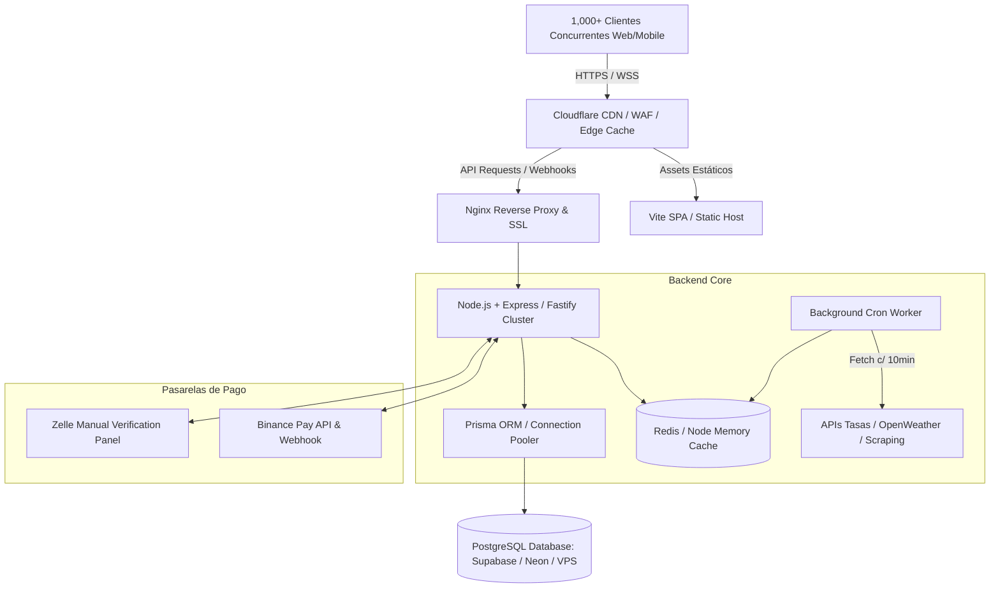
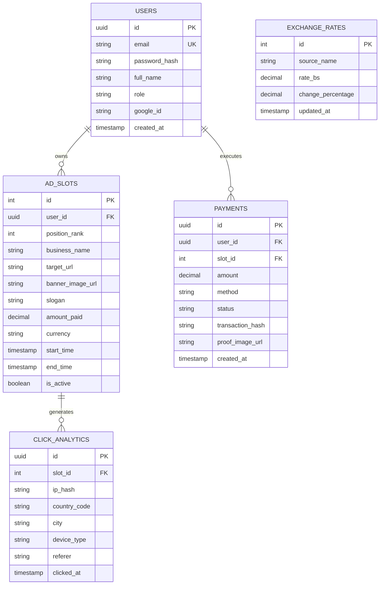

# 🏛️ PROYECTO VENFI (Venezuela + Finanzas)
## DOCUMENTO DE DEFINICIÓN TÉCNICA, LEGAL Y ESTRATÉGICA — FASE 0: PREPARACIÓN Y DOCUMENTACIÓN

---

## 1. 🌐 ESTRATEGIA DE DOMINIO Y BRANDING

### 1.1. Análisis y Selección de Nombres de Dominio
Para maximizar el posicionamiento SEO, la recordación de marca y la confianza de la diáspora y usuarios locales, se evaluaron las siguientes alternativas de nombres y extensiones TLD:

| Dominio Sugerido | TLD | Propósito / Enfoque | Prioridad | Costo Estimado Anual |
| :--- | :--- | :--- | :--- | :--- |
| **`venfi.app`** | `.app` | Moderno, enfocado en web application / PWA móvil con HTTPS forzado de fábrica. | **Opción 1 (Recomendada)** | ~$14 - $18 / año |
| **`venfi.lat`** | `.lat` | Regional, alta disponibilidad y precio competitivo para Latinoamérica. | **Opción 2** | ~$10 - $15 / año |
| **`venfihoy.com`** | `.com` | Sentido de inmediatez informativa diaria (tasas en tiempo real). | **Opción 3** | ~$12 - $15 / año |
| **`venfi.io`** | `.io` | Atractivo para el público tech, cripto y traders (Binance/USDT). | **Opción 4** | ~$35 - $45 / año |
| **`tasa-venfi.com`** | `.com` | Altamente optimizado para búsquedas orgánicas ("tasa bcv venfi"). | **Alternativa SEO** | ~$10 - $14 / año |

> **Recomendación del Arquitecto:** Adquirir `venfi.app` como dominio principal para la aplicación web y registrar `venfi.lat` o `venfihoy.com` como redirección preventiva para proteger la marca ante competidores.

---

### 1.2. Identidad Visual y Sistema de Diseño (Design Tokens)
La plataforma debe transmitir **solidez financiera**, **agilidad tecnológica** y **estatus publicitario premium** (para el Ranking Top 10).

```
+-------------------------------------------------------------------------+
| PALETA DE COLORES "VENFI DARK MATRIX"                                    |
+-------------------------------------------------------------------------+
| [ #070B14 ] Navy Deep Background (Fondo general inmersivo)               |
| [ #0E1726 ] Card Dark Slate (Superficies de componentes y widgets)       |
| [ #00F59B ] Neon Emerald / Bullish (Acción principal, ganancias, tasas)  |
| [ #FF4D4D ] Neon Coral / Bearish (Variaciones negativas, alertas)       |
| [ #FFD700 ] Gold Sovereign #1 (Puesto #1 VIP, bordes brillantes, brillos)|
| [ #E2E8F0 ] High-Contrast Text (Textos principales legibles)            |
| [ #64748B ] Muted Text (Subtítulos, marcas de tiempo, metadatos)         |
+-------------------------------------------------------------------------+
```

* **Tipografía:**
  * Primaria (UI & Headings): `Outfit` o `Inter` (Google Fonts) — moderna, geométrica y con alta legibilidad.
  * Numérica (Tasas & Calculadora): `JetBrains Mono` o `Chakra Petch` — monoespaciada para evitar saltos visuales al actualizar precios y contadores en tiempo real.
* **Microinteracciones:** Glassmorphism suave (`backdrop-filter: blur(12px)`), bordes con degradados sutiles (`border: 1px solid rgba(255,255,255,0.08)`), animaciones de pulso para el puesto #1 del Ranking y efecto ticker para el feed de tasas.

---

## 2. 🏗️ ARQUITECTURA DE INFRAESTRUCTURA Y STACK TECNOLÓGICO

### 2.1. Requerimiento: 1,000 Usuarios Concurrentes
Para soportar 1,000 usuarios concurrentes sin saturar el backend ni agotar las cuotas de las APIs externas de scraping/tasas:
1. **Frontend Edge Delivery:** Alojado y distribuido a través de CDN (Cloudflare / Vercel Edge Network), sirviendo assets estáticos comprimidos en Gzip/Brotli.
2. **Reverse Proxy & Anti-DDoS:** Cloudflare delante del servidor con reglas de rate limiting y cache agresivo de respuestas públicas (Cache TTL: 60 segundos para tasas públicas).
3. **In-Memory Cache (Redis o Node-Cache):** Las peticiones concurrentes de tasas de cambio no golpean la base de datos ni las APIs externas directamente; se sirven desde un buffer en memoria RAM actualizado por un Worker/Cron en segundo plano cada 5-15 minutos.
4. **Pool de Conexiones DB:** PostgreSQL gestionado con `pgBouncer` o conexión serverless optimizada (Supabase / Neon con pooling habilitado).



---

### 2.2. Comparativa y Selección de Proveedores

| Componente | Opción Evaluada | Pros | Contras | Decisión Técnica |
| :--- | :--- | :--- | :--- | :--- |
| **Hosting Backend / VPS** | **Hetzner Cloud (CPX21)** / **DigitalOcean Droplet** (2 vCPU, 4GB RAM) | Excelente rendimiento/precio, IP dedicada, control total sobre Docker y Nginx. | Requiere configuración de servidor Linux (automatizable vía scripts). | **RECOMENDADO: VPS Hetzner o DigitalOcean + Docker Compose** |
| **Base de Datos** | **Supabase (PostgreSQL gestionado)** | Dashboard visual intuitivo, Row Level Security, backups automáticos, Auth listo si se requiere. | Capa gratuita con pausa si está inactiva; upgrade a $25/mes en producción. | **RECOMENDADO: Supabase PostgreSQL (Plan Pro/Free)** |
| **Base de Datos (Alt)** | **Neon Serverless Postgres** | Escalado instantáneo a 0, branching de BD para pruebas. | Latencia de cold start en capa gratuita. | Alternativa de contingencia |
| **CDN / DNS / Seguridad** | **Cloudflare Free / Pro** | Protección DDoS líder, CDN global, certificados SSL automáticos, WAF. | Ninguna relevante para este nivel. | **RECOMENDADO (Indispensable)** |
| **Almacenamiento de Banners** | **Cloudflare R2 / AWS S3** | Costo $0 por egress (Cloudflare R2), compatible con S3 API. | Configuración inicial de bucket. | **RECOMENDADO: Cloudflare R2** |

---

## 3. ⚖️ BORRADOR LEGAL BLINDADO — TÉRMINOS Y CONDICIONES

A continuación se presenta el marco contractual y legal diseñado específicamente para blindar a la plataforma frente a reclamos civiles, comerciales o regulatorios en Venezuela y a nivel internacional:

```markdown
================================================================================
TÉRMINOS Y CONDICIONES DE USO Y CONTRATACIÓN DE ESPACIOS PUBLICITARIOS — VENFI
================================================================================
Última actualización: Agosto 2026

1. NATURALEZA JURÍDICA DE LA PLATAFORMA
Venfi (en adelante, "LA PLATAFORMA") es un portal web de agregación informativa,
herramientas de cálculo referencial y comercialización de espacios publicitarios
digitales (Código de Actividad Económica SENIAT 8299: Otros servicios empresariales
y de publicidad).

LA PLATAFORMA NO ES:
a) Una entidad financiera, casa de cambio, institución bancaria, billetera de
   custodia ni transmisor de dinero regulado por SUDEBAN ni SUNACRIP.
b) Una plataforma de juegos de azar, envite, lotería o apuestas. Las posiciones
   en el "Ranking Publicitario Top 10" corresponden a adquisiciones voluntarias
   de espacios de visibilidad comercial basados en tarifas públicas y directas,
   no mediadas por la suerte, azar ni sorteos.
c) Un asesor financiero ni de inversiones. Los valores cambiarios mostrados
   tienen carácter estrictamente INFORMATIVO y REFERENCIAL.

2. CLÁUSULA DE DESLINDE DE RESPONSABILIDAD CAMBIARIA (DISCLAIMER)
Las tasas de cambio correspondientes al Banco Central de Venezuela (BCV), tipo de
cambio paralelo e indicadores internacionales son recopiladas de fuentes públicas
terceras. LA PLATAFORMA no emite, fija, manipula ni garantiza la exactitud en
tiempo real de dichas cotizaciones. Cualquier transacción comercial, compra o
venta de divisas realizada entre usuarios o con terceros fuera de este sitio es
de la exclusiva responsabilidad y riesgo de las partes involucradas.

3. CONTRATACIÓN Y CONDICIONES DEL RANKING PUBLICITARIO (TOP 10)
3.1. Objeto del Servicio: El Usuario Anunciante paga una tarifa fija por el derecho
     temporal a exhibir un enlace, nombre comercial, logotipo y eslogan en una de
     las diez (10) posiciones disponibles del "Ranking Top 10".
3.2. Mecanismo de Visibilidad: La permanencia y prelación en el Ranking se rige
     por la tarifa contratada y el tiempo estipulado en la oferta vigente al momento
     del pago. En caso de desplazamiento por una puja o adquisición superior de otro
     anunciante, el anuncio desplazado descenderá de categoría conforme a la regla
     técnica preestablecida y visible en el panel.
3.3. Política de Contenido Aceptable: Queda terminantemente prohibida la publicidad
     de esquemas ponzi/piramidales no regulados, contenido pornográfico o ilícito,
     sustancias prohibidas, venta de armas, o cualquier actividad tipificada como
     delito en la legislación vigente. LA PLATAFORMA se reserva el derecho de veto
     y remoción inmediata sin derecho a reembolso si se viola esta cláusula.

4. POLÍTICA DE PAGOS Y REEMBOLSOS
4.1. Pagos mediante Criptoactivos (Binance Pay / USDT): Procesados de forma automática.
     El anuncio se publicará una vez confirmada la transacción en la red.
4.2. Pagos en Moneda Fiduciaria (Zelle / Transferencias): Requieren verificación
     manual del comprobante por el equipo de administración (tiempo estimado: 15 a
     60 minutos).
4.3. Política de "No Reembolso": Al tratarse de un servicio digital de despliegue
     inmediato, los pagos confirmados no son reembolsables una vez que el anuncio
     ha sido publicado en el ranking.

5. JURISDICCIÓN Y RESOLUCIÓN DE CONFLICTOS
Los presentes Términos se rigen por las leyes mercantiles y de comercio electrónico
de la República Bolivariana de Venezuela, acordando las partes someter cualquier
controversia a los tribunales competentes de la jurisdicción del domicilio fiscal
del operador de la plataforma.
================================================================================
```

---

## 4. 💰 PRESUPUESTO ESTIMADO Y CRONOGRAMA FINANCIERO

### 4.1. Costos de Infraestructura y Servicios (Recurrentes)

| Concepto | Proveedor Recomendado | Costo Mensual ($ USD) | Costo Anual ($ USD) | Observaciones |
| :--- | :--- | :--- | :--- | :--- |
| **Dominio Web** | Cloudflare Registrar / Namecheap | — | $14.00 - $18.00 | Dominio `.app` o `.lat` |
| **Servidor VPS (Backend & Cache)** | DigitalOcean / Hetzner Cloud | $12.00 - $24.00 | $144.00 - $288.00 | 2 vCPU, 4GB RAM, 80GB NVMe |
| **Base de Datos PostgreSQL** | Supabase (Free Tier -> Pro) | $0.00 (Meses 1-3) -> $25.00 | $0.00 - $225.00 | Inicia gratis, escala según volumen |
| **Cloudflare WAF / CDN / SSL** | Cloudflare Free Tier | $0.00 | $0.00 | Capa gratuita cubre 1,000+ concurrentes |
| **API Clima (OpenWeather)** | OpenWeather Free Tier | $0.00 | $0.00 | 1,000 llamadas/día (con cache interno: 100/día) |
| **APIs Tasas / Scraping Worker** | Worker interno / APIs públicas | $0.00 | $0.00 | Scraping propio con rotación y rate-limit |
| **Certificados SSL & Seguridad** | Let's Encrypt / Cloudflare | $0.00 | $0.00 | 100% automatizado |
| **TOTAL OPERATIVO BASE** | — | **~$12.00 - $24.00 / mes** | **~$158.00 - $306.00 / año** | **Altamente eficiente** |

---

### 4.2. Estimación de Esfuerzo y Fases de Desarrollo

```
+-----------------------------------------------------------------------------------+
| ROADMAP DE DESARROLLO VENFI (CRONOGRAMA DE ENTREGABLES)                           |
+-----------------------------------------------------------------------------------+
| [FASE 0] Preparación, Dominio, Legal, Arquitectura (Semana 1)  -> ESTADO: ACTUAL |
| [FASE 1] Frontend Base: UI/UX, Tema Dark, Blueprint (Semanas 2-3)                 |
| [FASE 2] Backend & PostgreSQL: Auth JWT, CRUD Ranking, APIs (Semanas 4-5)        |
| [FASE 3] Anzuelos & APIs: BCV, Paralelo, Clima, Remesas (Semana 6)                |
| [FASE 4] Pasarelas de Pago: Binance Pay (USDT) + Zelle (Semana 7)                |
| [FASE 5] Dashboard Anunciante: Gráficas de Clics, Geo, FOMO (Semanas 8-9)        |
| [FASE 6] Hardening, Optimización 1k Concurrency & Lanzamiento (Semana 10)         |
+-----------------------------------------------------------------------------------+
```

---

## 5. 🗄️ MODELO PRELIMINAR DE BASE DE DATOS (POSTGRESQL)

Para garantizar consistencia y rendimiento, se define el esquema relacional inicial:



---

## 6. 🚀 CRITERIOS DE APROBACIÓN PARA AVANZAR A FASE 1

Para dar por concluida la **FASE 0** e iniciar formalmente la **FASE 1 (Frontend Base - La "Cáscara")**, se requiere la validación del usuario sobre:
1. Confirmación de la opción de dominio preferida (`venfi.app`, `venfi.lat` o `venfihoy.com`).
2. Aprobación del borrador de Términos y Condiciones legales.
3. Validación del presupuesto de infraestructura inicial ($12 - $24/mes).
4. Autorización formal para arrancar con el andamiaje del proyecto en React + Vite con arquitectura responsive y tema oscuro.
