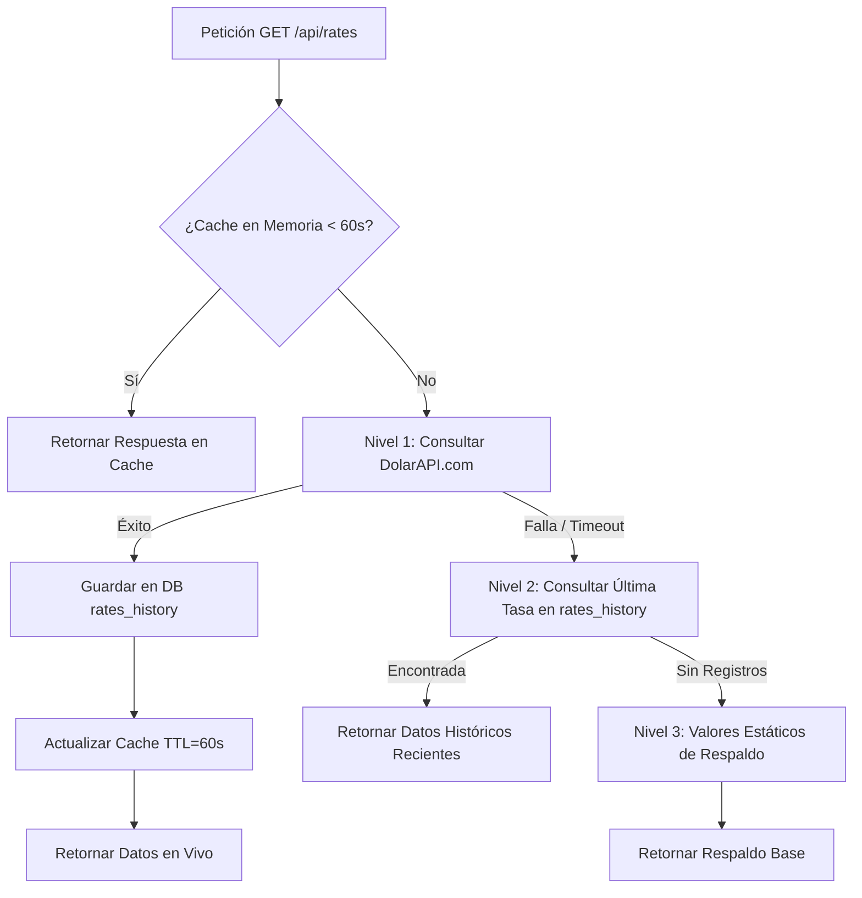

# 🪝 PROYECTO VENFI (Venezuela + Finanzas)
## FASE 3: INTEGRACIÓN DE ANZUELOS (APIs EXTERNAS)
### REPORTE DE EJECUCIÓN — TAREA 3.1: TASAS DE CAMBIO REALES

---

### 1. Resumen de la Tarea 3.1
Se ha integrado con éxito el servicio de consulta y sincronización de tasas cambiarias reales en **Venfi**, implementando la conexión con **DolarAPI.com**, almacenamiento histórico en la base de datos PostgreSQL (`rates_history`), caché en memoria RAM con TTL de 60 segundos y un sistema de fallback de 3 niveles para garantizar alta disponibilidad ininterrumpida.

* **Endpoint Principal:** `GET http://localhost:5000/api/rates`
* **Endpoint de Histórico:** `GET http://localhost:5000/api/rates/history`
* **Sincronización Frontend:** Integrado en `App.jsx` con auto-actualización cada 60s.

---

### 2. Arquitectura de Resiliencia y Fallback (3 Niveles)



---

### 3. Modelo de Datos: Tabla `rates_history`

```sql
CREATE TABLE IF NOT EXISTS rates_history (
    id SERIAL PRIMARY KEY,
    rate_type VARCHAR(20) NOT NULL, -- bcv, paralelo, usdt, euro
    buy_rate DECIMAL(10,4),
    sell_rate DECIMAL(10,4),
    avg_rate DECIMAL(10,4) NOT NULL,
    last_updated TIMESTAMPTZ DEFAULT CURRENT_TIMESTAMP
);

CREATE INDEX IF NOT EXISTS idx_rates_history_type_date ON rates_history(rate_type, last_updated DESC);
```

---

### 4. Cotizaciones Obtenidas en Vivo (Verificación Real)

| Divisa / Indicador | Tasa Actual (Bs.) | Fuente de Datos | Origen (Data Source) | Brecha Cambiaria |
| :--- | :--- | :--- | :--- | :--- |
| **Dólar BCV (Oficial)** | `787.52` Bs | Banco Central de Venezuela | `live_api` | Base oficial |
| **Dólar Paralelo** | `927.73` Bs | EnParaleloVzla / Monitor | `live_api` | **+17.80% (+140.21 Bs)** |
| **Binance P2P (USDT)** | `929.59` Bs | Binance P2P Market | `live_api` | **+18.04% (+142.07 Bs)** |
| **Euro BCV (Oficial)** | `919.15` Bs | BCV Oficial | `live_api` | Oficial EUR |

---

### 5. Tarea 3.2: Integración de Clima (OpenWeatherMap & Multi-Ciudad)
Se ha implementado el servicio de clima en tiempo real para las principales ciudades de Venezuela (**Caracas**, **Maracaibo**, **Valencia** y **Barquisimeto**) en [weatherService.ts](file:///home/xrafa387/Escritorio/Proyecto%20Venfi/backend/src/services/weatherService.ts) con sistema de resiliencia de 3 niveles y selector interactivo en el Header.

* **Endpoints Implementados:**
  * `GET http://localhost:5000/api/weather?city=Caracas` (Consulta por ciudad).
  * `GET http://localhost:5000/api/weather/cities` (Consulta simultánea de Caracas, Maracaibo y Valencia).
* **Niveles de Resiliencia:**
  1. **Nivel 1:** OpenWeatherMap API (utilizando `OPENWEATHER_API_KEY` en `.env`).
  2. **Nivel 2:** Open-Meteo API (sin límite de API key, datos meteorológicos globales).
  3. **Nivel 3:** Fallback estacional venezolano.
* **Caché en Memoria RAM:** 10 minutos (TTL = 600s).
* **Frontend Widget:** Selector integrado en el Header para alternar entre Caracas (`28°C`), Maracaibo (`32°C`) y Valencia (`28°C`).

---

### 6. Tarea 3.3: Comparador de Remesas en Tiempo Real
Se implementó el motor de cálculo y comparación de remesas a Venezuela en [remesasService.ts](file:///home/xrafa387/Escritorio/Proyecto%20Venfi/backend/src/services/remesasService.ts) integrando cotizaciones dinámicas y comisiones de las principales plataformas:

* **Endpoint Principal:** `GET http://localhost:5000/api/remesas?amount=100`
* **Estructura de Datos:**
  ```json
  {
    "monto_enviado_usd": 100,
    "mejor_opcion": "Binance P2P (USDT)",
    "diferencia_bs_ganancia": 832.90,
    "opciones": [
      {
        "plataforma": "Binance P2P (USDT)",
        "tasa_bs_por_usd": 62.50,
        "comision_usd": 0.00,
        "monto_neto_usd": 100.00,
        "monto_final_bs": 6250.00,
        "tiempo_estimado": "5 - 15 min (Inmediato)",
        "metodos_pago": ["PagoMóvil", "Transferencia Bancaria"],
        "calificacion": 4.9,
        "url_afiliado": "https://p2p.binance.com/es-LA",
        "es_recomendado": true
      },
      {
        "plataforma": "Airtm Cashier",
        "tasa_bs_por_usd": 61.07,
        "comision_usd": 3.60,
        "monto_neto_usd": 96.40,
        "monto_final_bs": 5887.15,
        "tiempo_estimado": "10 - 30 min",
        "es_recomendado": false
      },
      {
        "plataforma": "Zoom Envíos / Western Union",
        "tasa_bs_por_usd": 58.50,
        "comision_usd": 6.50,
        "monto_neto_usd": 93.50,
        "monto_final_bs": 5469.75,
        "tiempo_estimado": "1 - 4 horas",
        "es_recomendado": false
      }
    ]
  }
  ```
* **Frontend:** Conexión interactiva en [RemittanceComparator.jsx](file:///home/xrafa387/Escritorio/Proyecto%20Venfi/frontend/src/components/RemittanceComparator.jsx) recalculando en caliente cada vez que el usuario ingresa un nuevo monto en USD.


