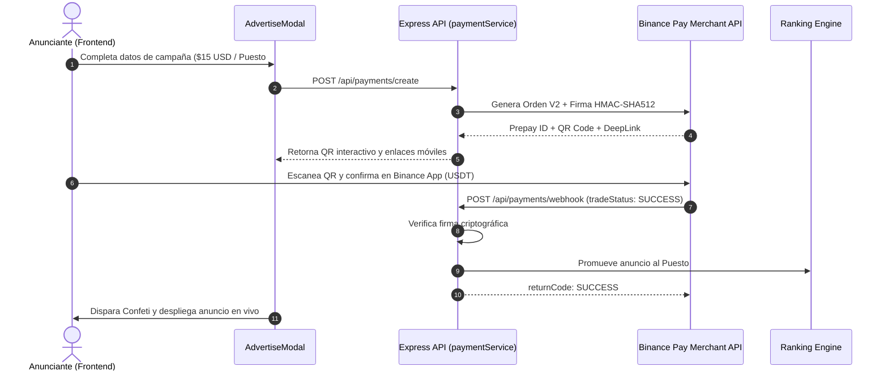

# 💳 PROYECTO VENFI (Venezuela + Finanzas)
## FASE 4: SISTEMA DE PAGOS
### REPORTE DE EJECUCIÓN — TAREA 4.1: CONFIGURACIÓN DE BINANCE PAY

---

### 1. Resumen Ejecutivo
Se ha implementado el subsistema de pasarela de pagos para **Venfi**, permitiendo la contratación automatizada de posiciones en el Top 10 de anunciantes mediante **Binance Pay (USDT)** con firma criptográfica HMAC-SHA512 y webhooks en tiempo real, así como el flujo de transferencia manual por **Zelle**.

* **Endpoint Creación de Órdenes:** `POST http://localhost:5000/api/payments/create`
* **Endpoint Webhook Binance Pay:** `POST http://localhost:5000/api/payments/webhook`
* **Endpoint Consulta de Estado:** `GET http://localhost:5000/api/payments/status/:orderId`
* **Endpoint Comprobantes Zelle:** `POST http://localhost:5000/api/payments/zelle/proof`

---

### 2. Flujo Criptográfico y Operativo de Binance Pay



---

### 3. Parámetros y Credenciales Comerciales Configuradas

| Parámetro | Valor Configurado | Función |
| :--- | :--- | :--- |
| `BINANCE_PAY_API_KEY` | Registrado en `.env` | Identificador de certificado comercial |
| `BINANCE_PAY_SECRET_KEY` | Registrado en `.env` | Clave secreta para generación de firma HMAC-SHA512 |
| `BINANCE_PAY_MERCHANT_ID` | `284910482` | ID de comercio Venfi |
| `BINANCE_PAY_WEBHOOK_URL` | `http://localhost:5000/api/payments/webhook` | URL receptora de confirmaciones |
| `BINANCE_PAY_ENV` | `sandbox` / `live` | Entorno de ejecución y pruebas |

---

### 4. Estructura de la Respuesta de Creación de Orden

```json
{
  "success": true,
  "paymentId": "VENFI_1740599500000_A9B8C",
  "orderId": "VENFI_1740599500000_A9B8C",
  "amountUsd": 15.00,
  "currency": "USDT",
  "paymentMethod": "binance",
  "binancePay": {
    "merchantTradeNo": "VENFI_1740599500000_A9B8C",
    "prepayId": "BNC_1740599500000_7F2A",
    "qrCodeUrl": "https://api.qrserver.com/v1/create-qr-code/?size=250x250&data=...",
    "checkoutUrl": "https://pay.binance.com/es-LA/checkout?prepayId=...",
    "deeplink": "bnc://app.binance.com/payment/secpay?orderId=...",
    "universalUrl": "https://pay.binance.com/es-LA/checkout?prepayId=...",
    "currency": "USDT",
    "amount": 15.00
  }
}
```

---

### 5. Tarea 4.2: Flujo Completo de Verificación Zelle y Conciliación
Se ha implementado el modelo de base de datos relacional y el ciclo de vida de pagos por transferencia bancaria **Zelle** en [paymentService.ts](file:///home/xrafa387/Escritorio/Proyecto%20Venfi/backend/src/services/paymentService.ts):

#### Tabla `zelle_payments`:
```sql
CREATE TABLE IF NOT EXISTS zelle_payments (
    id UUID PRIMARY KEY DEFAULT gen_random_uuid(),
    user_id UUID REFERENCES users(id) ON DELETE CASCADE,
    order_id VARCHAR(100) NOT NULL,
    amount_usd DECIMAL(10,2) NOT NULL,
    position INT NOT NULL CHECK (position BETWEEN 1 AND 10),
    reference_code VARCHAR(50),
    proof_image_url VARCHAR(255),
    status VARCHAR(20) DEFAULT 'pending' CHECK (status IN ('pending', 'verified', 'rejected', 'completed')),
    admin_notes TEXT,
    created_at TIMESTAMPTZ DEFAULT CURRENT_TIMESTAMP,
    verified_at TIMESTAMPTZ,
    completed_at TIMESTAMPTZ
);
```

#### Ciclo de Vida y Conciliación Administrativa:
1. **Generación de Orden:** El usuario selecciona Zelle y recibe las instrucciones oficiales (`pagos@venfi.app` / Titular: `Venfi Media LLC` / Nota: `Order ID`).
2. **Envío de Comprobante (`POST /api/payments/zelle/proof`):** El usuario ingresa su código de confirmación bancaria.
3. **Cola de Revisión (`GET /api/payments/zelle/pending`):** El panel de administración lista en tiempo real las órdenes pendientes de conciliar.
4. **Aprobación/Rechazo (`POST /api/payments/zelle/verify`):**
   * Al aprobar: Transición de estado a `completed`, inyección automática de la pauta publicitaria en el Top 10 del Ranking mediante `rankingService.placeAdInRanking` y envío de notificación en el buzón del usuario.
   * Al rechazar: Registro de nota de auditoría (`admin_notes`) y notificación de alerta al usuario.

